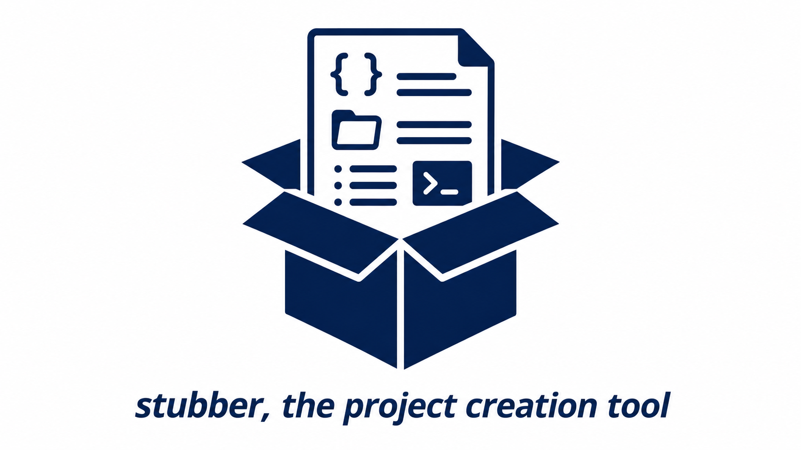

# stubber
___
A CLI tool that generates the directory structure, build scripts, and packaging
metadata for a new Go project, following a personal CI/CD convention: Alpine
(APK), Debian/Ubuntu (DEB), RHEL/Fedora (RPM), Arch Linux (PKGBUILD), and
Windows (.msi) packaging stubs, plus a ready-to-build Go skeleton.

Optionally, stubber also creates the project's git repository on its forge
(Forgejo, GitHub or Bitbucket Cloud) and pushes the scaffolded code to it.

Everything is generated from templates embedded in the binary
(`src/assets/`, embedded via `go:embed` in `src/assets/assets.go`), with
placeholders substituted at run time from the flags you pass.

---

## Contents

- [How it works](#how-it-works)
- [Installation](#installation)
- [Quick start](#quick-start)
- [Usage](#usage)
  - [Global flags](#global-flags)
  - [`create` flags](#create-flags)
  - [`refresh` flags](#refresh-flags)
  - [Examples](#examples)
- [Git repository creation (`-G`)](#git-repository-creation--g)
  - [Connections (`stubber conn`)](#connections-stubber-conn)
  - [Recovering from a failed `-G`](#recovering-from-a-failed--g)
- [The project manifest (`<softwarename>.json`)](#the-project-manifest-softwarenamejson)
- [Generated layout](#generated-layout)
  - [Skeleton (`-k`)](#skeleton--k)
  - [Alpine (`-a`)](#alpine--a)
  - [Debian (`-d`)](#debian--d)
  - [RedHat (`-r`)](#redhat--r)
  - [ArchLinux (`-A`)](#archlinux--a)
  - [Windows (`-w`)](#windows--w)
- [Template placeholders](#template-placeholders)
- [Assets management](#assets-management)
- [Shell completion](#shell-completion)
- [Building from source](#building-from-source)
- [Building packages](#building-packages)
- [Known issues / caveats](#known-issues--caveats)
- [License](#license)

---

## How it works

`stubber create` takes a software name and one or more "stub" flags
(`-A`, `-a`, `-d`, `-r`, `-w`, `-k`). Each stub flag tells stubber which set of
templated files to render into the project directory. Other flags (`-V`,
`-D`, `-M`, `-u`, etc.) supply the values used to fill in the placeholders in
those templates.

At `create` time stubber also writes a small
[`<softwarename>.json` manifest](#the-project-manifest-softwarenamejson) into the
project root (e.g. `mytool.json`), recording every value it used. `stubber
refresh` reads that manifest so it can re-render selected stubs while
**preserving the values you don't override** — you only pass the flags you want
to change.

With `-G`/`--git`, `create` then creates the repository named by `-u` on its
forge, as a **private** repository, and pushes the scaffolded code to its
`develop` branch — see [Git repository creation](#git-repository-creation--g).
Without `-G`, stubber only creates files. It never runs `go mod init` for you.
See [Caveats](#known-issues--caveats).

## Installation

Pre-built packages (`.apk`, `.deb`, `.rpm`, Arch `PKGBUILD`) are published on
the [Releases](https://github.com/jeanfrancoisgratton/stubber/releases) page.

Otherwise, build it yourself — see [Building from source](#building-from-source).

## Quick start

```sh
# Full project: Go skeleton + all five packaging stubs
stubber create -A -a -d -r -w -k \
  -V 1.0.0 -R 1 \
  -D "My awesome CLI tool" \
  -s utils \
  -u "https://git.famillegratton.net:3000/jfgratton/mytool" \
  mytool
```

This creates a `mytool/` directory in the current working directory containing
a buildable Go skeleton plus `__archlinux/`, `__alpine/`, `__debian/`,
`__redhat/`, and `__windows/` packaging stubs.

Add `-G` to also create the (private) `jfgratton/mytool` repository on that
forge and push everything to its `develop` branch; this needs a
[connection](#connections-stubber-conn) to the server first:

```sh
stubber conn add famillegratton       # once: server type, URL, credentials
stubber create -k -d -r -D "My awesome CLI tool" -s utils \
  -u "https://git.famillegratton.net:3000/jfgratton/mytool" -G mytool
```

> **Always review the generated files.** stubber is a *generic* stub
> generator — it doesn't know anything about your project beyond what you
> pass on the command line.

## Usage

```sh
stubber [global flags] <command> [command flags] <args>
```

Available commands:

| Command      | Description                                                |
|--------------|-------------------------------------------------------------|
| `create`     | Generates the directory structure (skeleton/stubs) for a new software project |
| `refresh`    | Re-renders selected stubs of an existing project, preserving unset values (reads/updates `<softwarename>.json`) |
| `conn`       | Manages the forge connections used by `create -G` (`list`, `info`, `add`, `edit`, `rm`) |
| `assets`     | Manage/inspect the templates embedded in the binary (e.g. `assets list`) |
| `completion` | Generates shell completion scripts (bash, zsh)             |
| `version`    | Prints stubber's own version and the Go toolchain version it was built with |

Run `stubber -h`, or `stubber <command> -h` (e.g. `stubber create -h`), for the
built-in help and examples at any time.

### Global flags

These apply to `stubber` itself and are inherited by all subcommands:

| Flag | Shorthand | Default | Description |
|------|-----------|---------|-------------|
| `--quiet` | `-q` | `false` | Silence non-essential output. |
| `--projectrootdir` | `-p` | `.` | `create`: directory in which to create the project. If left at the default, stubber creates and uses `./<SOFTWARENAME>`; otherwise it generates files directly into the given path (created if missing). `refresh`: the project root holding the manifest (the current directory by default). |
| `--binaryname` | `-b` | *(same as `<SOFTWARENAME>`)* | Name of the compiled binary. Used to name Alpine packaging scripts (`<binaryname>.post-install`, etc.) and as the `{{ BINARY NAME }}` placeholder. |
| `--gover` | `-g` | `1.27.3` | Go version to embed in generated files (`go.mod`, `go.version`, packaging scripts). |
| `--help` | `-h` | | Show help for any command. |

stubber's own version is shown by the `stubber version` command (there is no
`--version` flag).

### `create` flags

`stubber create` requires **exactly one** positional argument (the software
name), **at least one** of `-A`, `-a`, `-d`, `-r`, `-w`, `-k`, and the three
mandatory value flags `-D`, `-s`, `-u`:

```sh
stubber create [-A] [-a] [-d] [-r] [-w] [-k] -D <desc> -s <section> -u <url> [-G] [other flags] <SOFTWARENAME>
```

| Stub flag | Shorthand | What it generates |
|-----------|-----------|--------------------|
| `--archlinux` | `-A` | `__archlinux/` — `PKGBUILD` + build helper scripts (Arch Linux) |
| `--alpine`    | `-a` | `__alpine/` — `APKBUILD` + install/upgrade/deinstall scripts |
| `--debian`    | `-d` | `__debian/` — control file, build scripts, maintainer scripts |
| `--redhat`    | `-r` | `__redhat/` — spec file, `Makefile`-driven RPM build, changelog helper |
| `--windows`   | `-w` | `__windows/` — WiX `.wxs` source + `Makefile`-driven `.msi` build (Windows) |
| `--skeleton`  | `-k` | Go project skeleton: `src/`, `go.mod`, `main.go`, `cmd/root.go`, `cmd/completion.go`, build scripts, `README.md`, `CHANGELOG.md`, `ROADMAP.md`, `TODO.md`, `LICENSE`, etc. |

Value flags used to fill in the templates. `-D`, `-s`, and `-u` are
**mandatory** on `create` (marked ⭑ below) — even the ones with a default must
be supplied explicitly:

| Flag | Shorthand | Default | Description |
|------|-----------|---------|-------------|
| `--packagever` | `-V` | *(empty)* | Package version number — `{{ PACKAGE VERSION }}`. |
| `--packagerel` | `-R` | *(empty)* | Package release number — `{{ PACKAGE RELEASE }}`. |
| `--desc` ⭑ | `-D` | *(empty)* | **Required.** Package description — `{{ DESCRIPTION }}`. |
| `--maintainer` | `-M` | `Jean-Francois Gratton <jean-francois@famillegratton.net>` | Maintainer name/email — `{{ MAINTAINER }}`. **Override this if you're not me.** |
| `--packager` | `-P` | `APK Builder <builder@famillegratton.net>` | Packager name/email (Alpine) — `{{ PACKAGER }}`. **Override this too.** |
| `--section` ⭑ | `-s` | `Packaging tool` | **Required.** Debian package section / RPM `Group` — `{{ PACKAGE SECTION }}` / `{{ SECTION }}`. |
| `--depends` | `-e` | *(empty)* | Package dependencies, comma-separated — `{{ DEPENDENCIES }}`. Passed straight into the Debian `control` file, and rewritten into a quoted array for the Arch `PKGBUILD`. |
| `--url` ⭑ | `-u` | *(empty)* | **Required.** Git repository URL, `https://SERVER[:PORT]/OWNER/REPO` — `{{ URL }}`. With `-G`, also the repository to create. |
| `--manufacturer` | `-m` | `famillegratton.net` | Windows `.msi` Manufacturer/Publisher field. |

> These three are required on **`create`** only. `refresh` leaves `-D` and `-s`
> optional, since it preserves whatever the manifest already holds (and `-u` is
> not a `refresh` flag at all).

Git flags, `create` only:

| Flag | Shorthand | Default | Description |
|------|-----------|---------|-------------|
| `--git` | `-G` | `false` | Once the files are generated, create the `-u` repository (private) on its forge, then commit and push the scaffolded code on `develop`. See [Git repository creation](#git-repository-creation--g). |
| `--connection` | `-c` | *(inferred from `-u`)* | Connection to use with `-G`; mandatory only when several connections point to the `-u` server. See [Connections](#connections-stubber-conn). |

### `refresh` flags

`stubber refresh` re-renders the stubs of an *existing* project. It reads the
[`<softwarename>.json` manifest](#the-project-manifest-softwarenamejson) written
at `create` time, applies only the flags you actually pass on the command line
(everything else keeps its stored value), regenerates the requested stubs, and
writes the updated manifest back.

```sh
stubber refresh [-A] [-a] [-d] [-r] [-w] [-k] [value flags]
```

`refresh` takes **no positional argument**. Run it **from the project root** —
the directory that holds `<softwarename>.json` — and stubber discovers the single
manifest there (a `.json` whose contents name themselves), reading the software
name from it. You can point `-p` at that directory instead of `cd`-ing into it.
If the directory has no manifest (or more than one), `refresh` stops with an
error rather than guessing.

Which stubs get refreshed is driven entirely by the stub flags you pass:

| Stub flag | Shorthand | Effect on `refresh` |
|-----------|-----------|---------------------|
| `--archlinux` | `-A` | Re-render `__archlinux/` (created if missing) |
| `--alpine`    | `-a` | Re-render `__alpine/` (created if missing) |
| `--debian`    | `-d` | Re-render `__debian/` (created if missing) |
| `--redhat`    | `-r` | Re-render `__redhat/` (created if missing) |
| `--windows`   | `-w` | Re-render `__windows/Makefile`; create `__windows/<name>.wxs` if missing, **never** overwrite an existing one (see below) |
| `--skeleton`  | `-k` | Re-render **`go.version` only** (see below) |

- **Pass at least one stub flag.** If you pass none, `refresh` does nothing and
  says so — it never guesses which stubs to touch.
- Stubs you *don't* pass are left completely untouched. So `refresh -d` rewrites
  only `__debian/`, even if the project also has `__archlinux/`, `__redhat/`, etc.
- **`-k` is deliberately conservative**: it re-renders only `go.version`. It will
  **never** overwrite your real source (`src/main.go`, `src/cmd/root.go`, …) or
  your edited docs (`README.md`, `CHANGELOG.md`, …), even though `create -k`
  generates those files.
- **`-w` is deliberately conservative too, for a different reason**: the `.wxs`
  carries an `UpgradeCode` and a Component `Guid` that must stay the same for
  the life of the project (Windows uses them to recognize a new release as an
  *upgrade* of the old one, not a separate install) — see
  [Windows (`-w`)](#windows--w). So `refresh -w` only ever re-renders the
  `Makefile`; it creates the `.wxs` the first time and leaves it alone on
  every refresh after that.

The value flags (`-g`, `-V`, `-R`, `-D`, `-M`, `-P`, `-s`, `-e`, `-m`, and `-b`) work
exactly as in `create`, but here **omitting a flag means "keep the stored
value"** rather than "use the default". Note that `-u`/`--url` and `-G`/`--git`
are *not* `refresh` flags — the URL is preserved from the manifest but can't be changed via
`refresh` (edit `<softwarename>.json` or the generated files directly if you need to).

### Examples

Generate just a Go skeleton, targeting Go 1.27.3, in a custom directory
(`-D`/`-s`/`-u` are required on every `create`, even skeleton-only):

```sh
stubber create -k -g 1.27.3 -D "My awesome CLI tool" -s "utils" -u "https://git.example.com/me/mytool" -p ./projects/mytool mytool
```

Same, but also create the private `me/mytool` repository on GitHub and push
the skeleton to its `develop` branch:

```sh
stubber create -k -D "My awesome CLI tool" -s "utils" -u "https://github.com/me/mytool" -G mytool
```

Add Debian packaging to an existing project, with dependencies:

```sh
stubber create -d \
  -D "Backup helper for Docker volumes" \
  -s "admin" \
  -e "docker.io" \
  -M "Your Name <you@example.com>" \
  -u "https://git.example.com/me/dvol" \
  dvol
```

Generate RPM packaging only (`__redhat/`), with version/release set explicitly:

```sh
stubber create -r -V 2.3.0 -R 1 -D "My project" -s "utils" -u "https://git.example.com/me/myproj" myproj
```

Generate an Arch Linux `PKGBUILD` stub (`__archlinux/`):

```sh
stubber create -A -V 0.1.0 -R 1 -D "My awesome CLI tool" -s "utils" -u "https://git.example.com/me/mytool" mytool
```

Generate a Windows `.msi` stub (`__windows/`):

```sh
stubber create -w -V 0.1.0 -R 1 -D "My awesome CLI tool" -s "utils" -u "https://git.example.com/me/mytool" mytool
```

Generate everything quietly (e.g. from a script), with a binary name that
differs from the project name:

```sh
stubber -q create -A -a -d -r -w -k -b mytoolctl -V 0.1.0 -R 1 -D "My tool" -s "utils" -u "https://git.example.com/me/mytool" mytool
```

Bump the version and Go toolchain of an existing project, refreshing every
packaging stub it already has (run from inside the project root, no name needed):

```sh
cd mytool
stubber refresh -A -a -d -r -w -V 1.1.0 -R 1 -g 1.27.3
```

Change just the Debian dependencies, leaving everything else as-is (pointing
`-p` at the project instead of `cd`-ing in):

```sh
stubber refresh -d -e "docker.io, ca-certificates" -p ./mytool
```

Re-point only `go.version` at a new Go release, without touching any packaging
or source files:

```sh
stubber refresh -k -g 1.27.3 -p ./mytool
```

## Git repository creation (`-G`)

`stubber create -G` goes one step further than generating files:

1. The `-u` URL (`https://SERVER[:PORT]/OWNER/REPO`) names the repository: its
   server, its owner and its name. A trailing `.git` is accepted. The owner is
   the segment just before the repository name, and need not be you: a user, an
   organisation (Forgejo, GitHub) or a workspace (Bitbucket). Your account needs
   the right to create repositories there.
2. stubber picks the [connection](#connections-stubber-conn) whose server hosts
   that URL (or the one given with `-c`); the connection's type decides the
   backend (Forgejo, GitHub or Bitbucket Cloud), and its credentials are used
   throughout.
3. The repository is created **private**, with `-D` as its description. Making
   it public is left to you: by default, the most restrictive setting wins.
4. It is created **empty**: the scaffold already carries its own `README.md`
   and `.gitignore`, and a forge-side initial commit would only conflict with it.
5. The project directory is then initialized locally (`git init` on `develop`),
   everything is committed (*Initial commit: project scaffolded by stubber*),
   `origin` is set to the new repository, and `develop` is pushed. `develop`
   becomes the repository's default branch.

Before **anything** is written — locally or on the forge — stubber checks
everything it can without side effects:

- the URL matches a connection (and `-c` is given if several do);
- the connection is valid, and the forge accepts its credentials;
- the repository does not already exist on the forge;
- `git` is installed, has an identity (`user.name`/`user.email`) to commit
  with, and the project directory is not already a git repository.

A failure there stops stubber with *Nothing was created*: fix the cause, and
run the same command again. Only two things can still fail once the project is
scaffolded: the repository creation itself (ex: your account may not create
repositories in that organisation), and the push (ex: a network failure). In
both cases, see [Recovering from a failed `-G`](#recovering-from-a-failed--g).

The push credentials are passed to git through its environment: they never
appear on the command line, and are never written into `.git/config`.

### Connections (`stubber conn`)

Connections are kept in `$HOME/.config/JFG/stubber/connections.json` (secrets
encrypted). Each holds a server type (`forgejo`, `github`, `bitbucket`), the
server URL, and either an API token or a username/password pair (the token
wins when both are set; GitHub requires a token).

| Command | Description |
|---------|-------------|
| `stubber conn list` (`ls`) | Lists every connection, flagging invalid ones |
| `stubber conn info CONNECTION [CONNECTION...]` | Shows the details of the given connections (secrets are never shown) |
| `stubber conn add CONNECTION` | Adds a connection; you are prompted for its values |
| `stubber conn edit CONNECTION` | Edits a connection in place (ENTER keeps a value, `-` clears a secret) |
| `stubber conn rm CONNECTION` | Removes a connection |

There is **no default connection**: the one used is derived from `-u`, and
`-c CONNECTION` (`--connection`) is only needed to choose among several.
The server URL you give a connection is the forge's root, as it appears in
your repository URLs:

| Forge | Connection URL | Matching `-u` |
|-------|----------------|---------------|
| Forgejo | `https://git.example.net:3000` | `https://git.example.net:3000/me/mytool` |
| Forgejo, sub-path install | `https://example.com/forgejo` | `https://example.com/forgejo/me/mytool` |
| GitHub | `https://github.com` (or `https://api.github.com`) | `https://github.com/me/mytool` |
| Bitbucket Cloud | `https://bitbucket.org` (or `https://api.bitbucket.org/2.0`) | `https://bitbucket.org/myworkspace/mytool` |

API suffixes (`/api/v1`, `/api/v3`, `/2.0`) and default ports are ignored when
matching. The forge type is the matching connection's, never guessed from the
hostname, so GitHub Enterprise servers and Bitbucket proxies work as well.

- **One** connection points to the `-u` server: it is used; `-c` is optional
  (if given, it must name that connection).
- **Several** connections point to it (two GitHub accounts, say): `-c` is
  mandatory, and stubber lists the candidates if you forget it.
- **None**: stubber stops, and tells you to add one with `stubber conn add`.

`-c` works as in `gitclt`: it names a connection, whose token takes precedence
over its username/password. A `-c` connection that points to another server
than `-u`'s is refused, which also catches a typo in either. Using `-c`
without `-G` is an error.

Real-world examples (one connection per server, so no `-c`):

```sh
# Forgejo, in the "mainline" organisation
stubber create -k -D "Go project scaffolder" -s utils -u https://git.famillegratton.net:3000/mainline/stubber.git -G stubber
# GitHub and Bitbucket, under the personal account / workspace
stubber create -k -D "Go project scaffolder" -s utils -u https://github.com/jeanfrancoisgratton/stubber.git -G stubber
stubber create -k -D "Go project scaffolder" -s utils -u https://bitbucket.org/jeanfrancoisgratton/stubber.git -G stubber
```

With two GitHub connections (`gh-personal`, `gh-work`):

```sh
stubber create -k -D "My tool" -s utils -u https://github.com/someorg/mytool -G -c gh-work mytool
```

### Recovering from a failed `-G`

If repository creation or the push fails *after* the project was scaffolded,
the error says which, and where the project is. The simplest way out, when you
haven't touched the generated files yet: delete the project directory (and the
repository, if it was created and is still empty), fix the cause, and run the
same `stubber create` again.

Otherwise, finish by hand.

**1. The repository was not created.** Create it as an **empty, private**
repository — no README, `.gitignore` or license, the scaffold has its own:

- from the forge's web UI, or
- with `gitclt`, which uses the
  same connections (leave `--initialize` off):

  ```sh
  gitclt repo create -c CONNECTION -o OWNER --public=false --description "My tool" REPO
  ```

  On GitHub and Bitbucket, add `--defaultbranch ""`: neither accepts a default
  branch on an empty repository; pushing `develop` first makes it the default
  anyway.

**2. Commit and push.** From the project root, run whichever of these steps
weren't done yet (`git status` and `git remote -v` tell you where you are):

```sh
cd mytool
git init --initial-branch=develop       # or, if .git already exists: git switch -c develop
git add --all
git commit -m "Initial commit: project scaffolded by stubber"
git remote add origin https://git.example.net:3000/myorg/mytool.git   # or: git remote set-url origin ...
git push -u origin develop
```

This push authenticates with your own git setup (credential helper, or a
prompt): stubber never stores the connection's credentials in the project.
Finally, check in the forge's settings that `develop` is the default branch.

## The project manifest (`<softwarename>.json`)

Every `stubber create` run writes a `<softwarename>.json` file into the project
root (for a project named `mytool`, that's `mytool.json`). It is a lossless
record of the values used to render the stubs, plus which stubs the project
owns:

```json
{
  "softwarename": "mytool",
  "binaryname": "mytool",
  "goversion": "1.27.3",
  "versionnumber": "1.0.0",
  "defaultreleasenumber": "1",
  "description": "My awesome CLI tool",
  "maintainer": "Your Name <you@example.com>",
  "packager": "APK Builder <builder@famillegratton.net>",
  "section": "Packaging tool",
  "dependencies": "",
  "url": "https://git.example.com/me/mytool",
  "stubs": {
    "alpine": true,
    "debian": true,
    "redhat": true,
    "archlinux": true,
    "windows": true,
    "skeleton": true
  }
}
```

`stubber refresh` reads this file to recover the values for any flag you don't
pass, then rewrites it after a successful refresh (updating changed values and
recording any newly added stub type). This is why omitted flags are *preserved*
rather than reset — and why `refresh` needs no software name on the command
line: it discovers `<softwarename>.json` in the project root and reads the name
from there.

Keep `<softwarename>.json` under version control alongside the project. If it's
missing (e.g. a project created before this feature existed), `refresh` stops
with a "No manifest found" error and exits non-zero rather than guessing — it
never falls back to defaults, because that would silently overwrite your
metadata with empty/wrong values. To recover, hand-write a minimal manifest (the
JSON above is the full shape) or re-run `create`.

## Generated layout

The exact set of files generated depends on which of `-A` / `-a` / `-d` /
`-r` / `-w` / `-k` you pass. Combined, a full run (`-A -a -d -r -w -k`)
produces:

```
.
├── __alpine/
│   ├── APKBUILD
│   ├── Makefile
│   ├── <binary>.post-install
│   ├── <binary>.pre-install
│   ├── <binary>.pre-upgrade
│   ├── <binary>.post-upgrade
│   ├── <binary>.pre-deinstall
│   └── <binary>.post-deinstall
├── __archlinux/
│   ├── 1.install-build-deps.sh
│   ├── 2.build-package.sh
│   ├── Makefile
│   └── PKGBUILD
├── __debian/
│   ├── Makefile
│   ├── control
│   ├── copyright
│   ├── install-build-deps.sh
│   ├── restore_repo.sh
│   ├── preinst
│   ├── postinst
│   ├── prerm
│   └── postrm
├── __redhat/
│   ├── <SOFTWARENAME>.spec
│   ├── Makefile
│   ├── rpmbuild-deps.sh
│   └── updateChangelog.sh
├── __windows/
│   ├── <SOFTWARENAME>.wxs
│   └── Makefile
├── .gitignore
├── dontexec.sh
├── <SOFTWARENAME>.json
├── CHANGELOG.md
├── ISSUES.md
├── LICENSE
├── README.md
├── ROADMAP.md
├── TODO.md
├── go.version
└── src
    ├── build.sh
    ├── go.mod
    ├── main.go
    ├── updateBuildDeps.sh
    └── cmd
        ├── completion.go
        └── root.go
```

### Skeleton (`-k`)

A minimal but buildable Go project: `src/main.go`, `src/cmd/root.go` (a Cobra
root command), `src/cmd/completion.go` (bash/zsh completion subcommand),
`src/go.mod`, plus `build.sh` / `updateBuildDeps.sh` helper scripts and the
usual `README.md` / `CHANGELOG.md` / `ISSUES.md` / `ROADMAP.md` / `TODO.md` /
`LICENSE` / `.gitignore` / `go.version` files at the project root, plus
`dontexec.sh` (see [Building packages](#building-packages)).

### Alpine (`-a`)

`__alpine/APKBUILD` and `__alpine/Makefile` (`build` / `release` / `clean` /
`info`, reading package metadata straight from `APKBUILD`), plus one maintainer
script per package lifecycle hook (`post-install`, `pre-install`,
`pre-upgrade`, `post-upgrade`, `pre-deinstall`, `post-deinstall`), each named
`<binaryname>.<hook>` and made executable.

### Debian (`-d`)

`__debian/control` and `__debian/Makefile` (`build` / `upload` / `release` /
`clean` / `info`, reading package metadata straight from `control`), plus
`copyright`, `install-build-deps.sh`, `restore_repo.sh`, and maintainer scripts
(`preinst`, `postinst`, `prerm`, `postrm`).

`copyright` is a machine-readable DEP-5 file. Debian policy puts it in the
package at `/usr/share/doc/<package>/copyright` rather than in `DEBIAN/`, so the
`Makefile` installs it there, mode 0644 — everything else in `__debian/` is made
executable.

The `Makefile` folds together what the old numbered helper scripts did: it
copies — never moves — the `DEBIAN` control files into a throwaway staging
tree, so there is nothing to `git restore` afterwards.

### RedHat (`-r`)

As of stubber v2.00.00, RPM packaging lives entirely under `__redhat/` and is
driven by a `Makefile` instead of `tito`:

| File | Purpose |
|------|---------|
| `<SOFTWARENAME>.spec` | The RPM spec file |
| `Makefile` | Drives the build (`tarball`, `rpm`, `rpmcl`, `upload`, `commitcl`, `tag`, `release`, `clean` targets) |
| `rpmbuild-deps.sh` | Installs `BuildRequires` from the spec (via `dnf builddep`), plus the Go toolchain |
| `updateChangelog.sh` | Appends a `%changelog` entry from `git log` since the last tag |

`make release` is the intended entry point; it runs `rpmcl`, `commitcl`,
`upload` and `tag` in order. Two things about it are worth knowing:

- `commitcl` pushes the regenerated `%changelog` to `CL_BRANCH` (`develop` by
  default), **not** to the branch that was built. The builder checks out
  `origin/main`, so committing there would re-fire the CI hook and trigger a
  redundant rebuild of every distribution on each release. Override with
  `make commitcl CL_BRANCH=main` if you need to.
- `TAG` is `v$(VERSION)` with `~` rewritten to `-`, because RPM uses `~` as its
  pre-release separator but git forbids it in a ref name. `check-tags`
  validates the result with `git check-ref-format` before anything is built.

Typical workflow (from `__redhat/`):

```sh
make release    # the whole thing: rpmcl + commitcl + upload + tag
```

or, step by step:

```sh
make rpm        # build the RPM (tarball + rpmbuild -bb)
# or:
make rpmcl      # same, plus updates the spec's %changelog
make upload     # optional: push to a Nexus Repository Manager via nxtools
make commitcl   # push the updated %changelog to CL_BRANCH
make tag        # create and push v<version>
```

There is no `git push` step: `commitcl` pushes its own commit, and nothing in
the flow commits to the branch being built.

### ArchLinux (`-A`)

New in stubber v2.00.00. Generates `__archlinux/`:

| File | Purpose |
|------|---------|
| `PKGBUILD` | Standard Arch package build recipe (`makepkg`) |
| `Makefile` | `build` / `release` / `clean` / `info`, reading package metadata straight from `PKGBUILD` |
| `1.install-build-deps.sh` | Installs `base-devel` via `pacman` |
| `2.build-package.sh` | Runs `makepkg --force --syncdeps --noconfirm` and cleans up `src/`/`pkg/` |

Typical workflow (from `__archlinux/`):

```sh
./1.install-build-deps.sh   # once, to get base-devel
./2.build-package.sh        # builds the package via makepkg, output to /data
```

`{{ DEPENDENCIES }}` is rewritten on the way in: `-e "libc, bash-completion"`
is Debian-shaped, and pacman wants each element quoted separately, so the
generated `PKGBUILD` gets `depends=('libc' 'bash-completion')`.

### Windows (`-w`)

Generates `__windows/`:

| File | Purpose |
|------|---------|
| `<SOFTWARENAME>.wxs` | WiX source for the `.msi`, built with `wixl` (from the `msitools` package — a from-scratch, C, Linux-native reimplementation of the WiX toolchain; no Windows, .NET, or mono involved) |
| `Makefile` | `build` / `upload` / `release` / `clean` / `info`, reading package metadata straight from `<SOFTWARENAME>.json` via `jq` |

Windows has no distro package manager, so there is no control/spec/PKGBUILD/
APKBUILD equivalent to read metadata from. Instead the `Makefile` reads
`NAME`/`VERSION`/`BINARY`/`DESCRIPTION` straight out of the project's own
`<SOFTWARENAME>.json` manifest at build time, via `jq`. Practically everything
in the generated `Makefile` is fleet-generic and identical across projects;
the manifest filename is the only thing that varies.

`make build` cross-compiles with `GOOS=windows GOARCH=amd64 CGO_ENABLED=0`
and then runs `wixl` to package the `.exe` into a real `.msi`. This is meant
to run inside the `winbuilder` builder container (see the `docker_artifacts`
repo's `CLAUDE.md`, "Builders: winbuilder") — `wixl`, `jq`, and the Go
toolchain all need to be present, and the container also knows how to
bootstrap a `mingw-w64` cgo cross-toolchain on demand if a project's
`Makefile` ever needs `CGO_ENABLED=1`. `make release` uploads the `.msi` with
`nxtools` to `winLocal`, a raw Nexus repository.

**The `.wxs` carries two permanent identifiers that stubber generates once and
never touches again**: `UpgradeCode` (this project's Windows Installer
identity — every release shares it) and the main `Component`'s `Guid` (tied to
the installed path and key file). Windows uses these to recognize a newer
`.msi` as an *upgrade* of an older one rather than a separate, side-by-side
install; regenerating either would silently break that. `stubber create -w`
generates both as fresh random UUIDs; `stubber refresh -w` re-renders the
`Makefile` every time but **only creates the `.wxs` if it is missing** — an
existing one is left completely untouched, byte-for-byte, no matter what other
flags you pass. This is the same "create once, never clobber" idea behind
`refresh -k` only touching `go.version`, applied to the one place in the whole
tool where a template's content is actually load-bearing *state*, not just
rendered text.

Typical workflow (from `__windows/`):

```sh
make build     # cross-compile + package the .msi
make release   # build, then upload to winLocal via nxtools, then clean
```

## Template placeholders

If you customize the templates under `src/assets/` (see
[Building from source](#building-from-source)), these are the placeholders
stubber substitutes, and which flag/value feeds each one:

| Placeholder | Source | Used by |
|-------------|--------|---------|
| `{{ SOFTWARE NAME }}` | The `<SOFTWARENAME>` positional argument | all stubs (windows also uses it for the `.wxs`/manifest filenames, not just file content) |
| `{{ BINARY NAME }}` | `-b` / `--binaryname` (defaults to software name) | alpine, redhat, archlinux, skeleton |
| `{{ PACKAGE VERSION }}` | `-V` / `--packagever` | alpine, debian, redhat, archlinux, skeleton |
| `{{ PACKAGE RELEASE }}` | `-R` / `--packagerel` | alpine, debian, redhat, archlinux, skeleton |
| `{{ DESCRIPTION }}` | `-D` / `--desc` | alpine, debian, redhat, archlinux, skeleton |
| `{{ MAINTAINER }}` | `-M` / `--maintainer` | alpine, debian |
| `{{ PACKAGER }}` | `-P` / `--packager` | alpine only |
| `{{ SECTION }}` / `{{ PACKAGE SECTION }}` | `-s` / `--section` | redhat (`Group`), debian (`Section`), skeleton |
| `{{ DEPENDENCIES }}` | `-e` / `--depends` | debian (comma-separated), archlinux (rewritten into a quoted `depends=()` array) |
| `{{ URL }}` | `-u` / `--url` | alpine, redhat, archlinux, debian (`copyright`) |
| `{{ GO VERSION }}` | `-g` / `--gover` | alpine, debian, redhat, skeleton |
| `{{ GO MAJOR MINOR }}` | Derived from `{{ GO VERSION }}` (e.g. `1.26.4` → `1.26`) | skeleton (`go.mod`) |
| `{{ ARCHITECTURE }}` | Hardcoded `amd64` (Debian); Alpine maps `amd64` → `x86_64` internally; Arch/RPM hardcode `x86_64` in their templates | debian |
| `{{ COPYRIGHT YEAR }}` | Always the current year, generated automatically — no flag feeds it, and it is not stored in the manifest | debian (`copyright`) |
| `{{ RELEASE DATE }}` | Today's date (`YYYY.MM.DD`), generated automatically | alpine, debian, redhat, skeleton |
| `{{ UPGRADE CODE }}` | A freshly generated random UUID — no flag feeds it, and it is not stored in the manifest (the `.wxs` itself is the record) | windows only, and only when the `.wxs` doesn't already exist |
| `{{ COMPONENT GUID }}` | Same as `{{ UPGRADE CODE }}`: freshly generated, only when the `.wxs` doesn't already exist | windows only |

## Assets management

`stubber assets list` (alias `ls`) prints every template asset embedded in
the binary — handy for checking what's available, or for sanity-checking
after editing `src/assets/`:

```sh
stubber assets list
```

## Shell completion

stubber can generate Bash and Zsh completion scripts via Cobra:

```sh
# Bash, current session
source <(stubber completion bash)

# Bash, persistent
stubber completion bash | sudo tee /etc/bash_completion.d/stubber > /dev/null

# Zsh, current session
source <(stubber completion zsh)

# Zsh, persistent
stubber completion zsh > ~/.zsh/stubber
echo 'fpath=($HOME/.zsh $fpath)' >> ~/.zshrc
echo 'autoload -Uz compinit && compinit' >> ~/.zshrc
```

Fish/PowerShell completions are not provided.

As of v2.01.00, projects generated with `-k` also include their own
`src/cmd/completion.go`, so software built from the skeleton gets the same
`completion bash`/`completion zsh` subcommands for free.

## Building from source

```sh
git clone https://github.com/jeanfrancoisgratton/stubber.git
cd stubber/src
./build.sh
```

`build.sh` just runs `go build` — there's no separate asset-bundle
regeneration step. Templates under `src/assets/` (organized into `alpine/`,
`archlinux/`, `debian/`, `redhat/`, and `skeleton/`) are embedded directly via
`//go:embed` in `src/assets/assets.go`, so editing a template and rebuilding
is enough. `src/assets/template_handler.go` (`assets.ProcessEmbeddedAsset`)
reads an embedded asset, substitutes placeholders, and writes it into the
generated project tree.

The required Go version is tracked in `go.version` at the repo root
(currently 1.27.3).

## Building packages

The `__alpine/`, `__archlinux/`, `__debian/`, and `__redhat/` directories at
the repo root are stubber's *own* packaging stubs (generated by stubber, for
itself — dogfooding). The RPM workflow is described in the "RedHat (`-r`)"
section above; the Alpine/Arch/Debian stubs assume the author's home-lab build
containers, which aren't published.

`dontexec.sh`, at the repo root, creates or removes the `_dontexec` marker that
tells the build containers to skip a directory:

```sh
./dontexec.sh __redhat      # skip the RPM build
./dontexec.sh -r __redhat   # build it again
./dontexec.sh -g            # skip every build in this repo
```

Don't add `_dontexec` to `.gitignore`: the marker is read from the builder's own
checkout, so an ignored one never reaches it and the veto silently does nothing.

If you'd rather not build from source, grab a pre-built package from the
[Releases](https://github.com/jeanfrancoisgratton/stubber/releases) page.

## Known issues / caveats

- Without `-G`, stubber creates a directory structure only; it does **not**
  initialize a git repository for you. With `-G`, the repository is always
  created private, and on the `develop` branch.
- After running `stubber create -k`, `go.mod` / `go.sum` in the generated
  skeleton may need a `go mod init` / `go mod tidy` pass before `src/build.sh`
  will succeed.
- The packaging templates declare `GPL-3.0-or-later`, matching the `LICENSE`
  the skeleton ships (the full GPLv3 text, whose boilerplate grants "version 3
  ... or (at your option) any later version"). If your project uses a different
  license, change it in the generated `PKGBUILD` / `APKBUILD` / `.spec` /
  `__debian/copyright` **and** replace `LICENSE` — stubber does not derive
  those fields from anything, and nothing cross-checks them.
- Mainly tested on x86_64/amd64. Lightly tested on Apple Silicon (arm64);
  generated files may need extra tweaking on other architectures.
- The `__windows/` stub is untested against a real `-r`/`--redhat`-style
  build container as of this writing — only against `wixl` directly (which
  confirmed it produces a structurally valid `.msi`). It needs `jq`, `wixl`
  (the `msitools` package), and a Go toolchain cross-compiling to
  `GOOS=windows`, which the `docker_artifacts` fleet's `winbuilder` container
  provides.
- **Always review the generated files.** This is a generic stub generator; it
  doesn't validate the values you pass, and downstream packaging tools (`apk`,
  `dpkg-buildpackage`, `rpmbuild`, `makepkg`) are unforgiving of malformed
  metadata.

See [ISSUES.md](docs/ISSUES.md) for the current open-issue tracker.

## License

[GPL-3.0-or-later](LICENSE) — the full GPLv3 text, whose boilerplate grants
"version 3 of the License, or (at your option) any later version".

`LICENSE` sits at the repo root, matching where stubber puts it in the projects
it scaffolds. `CHANGELOG.md` and `ISSUES.md` still live under `docs/`, which
scaffolded projects get at their root instead.
